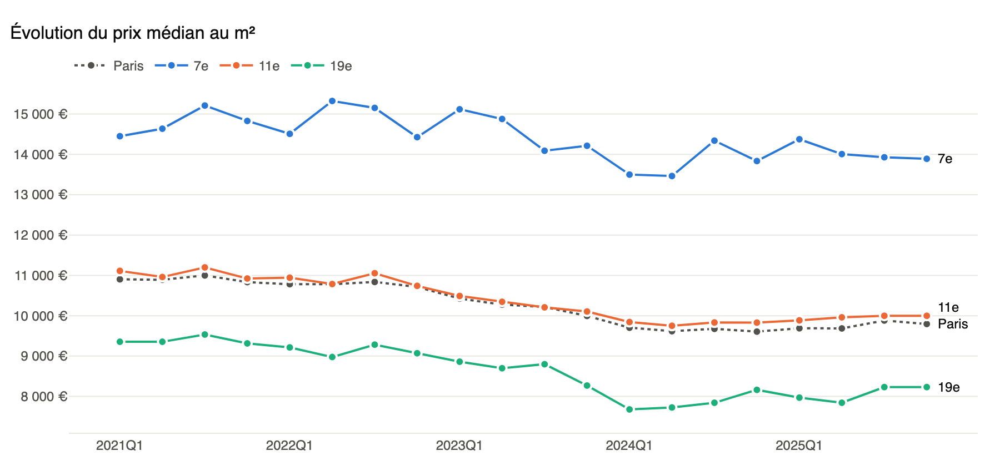
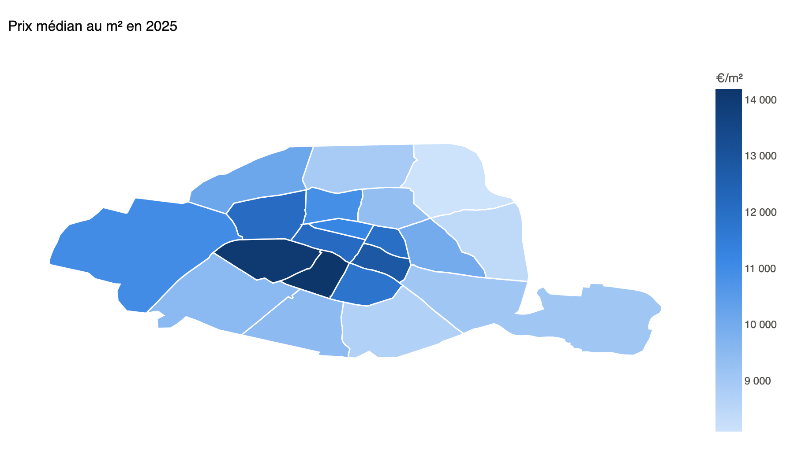
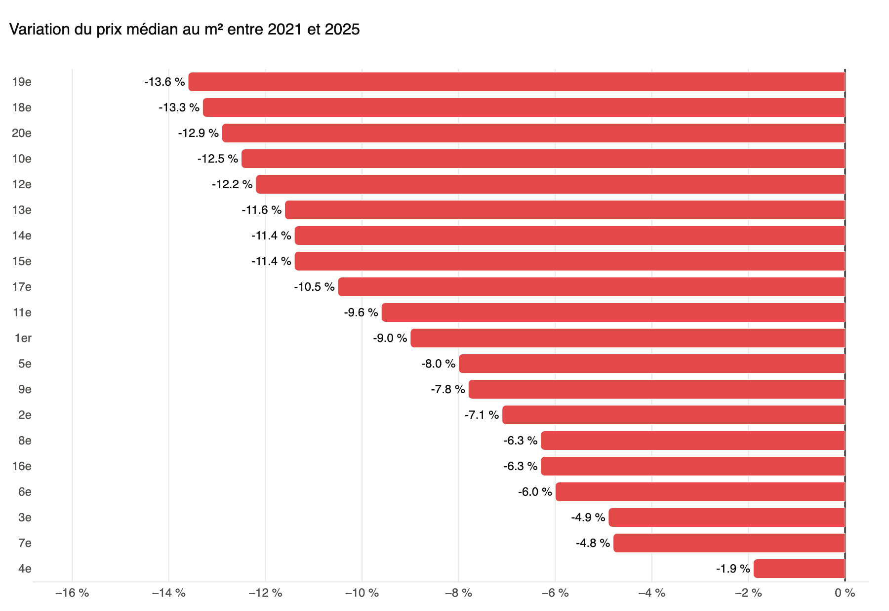
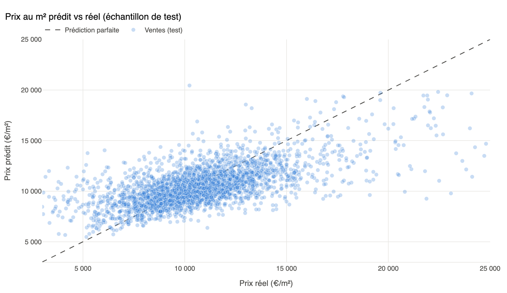

# Analyse du marché immobilier parisien (DVF)

Analyse des **143 589 ventes de logements à Paris entre 2021 et 2025**, à partir des données
publiques *Demandes de valeurs foncières* (DVF, [data.gouv.fr](https://www.data.gouv.fr/fr/datasets/demandes-de-valeurs-foncieres-geolocalisees/)) :
nettoyage avec **pandas**, analyses en **SQL** (DuckDB), modèle de prédiction des prix avec
**scikit-learn** et dashboard interactif **Streamlit**.

## Principaux résultats

- Le prix médian au m² à Paris est passé de **10 900 €** début 2021 à **9 800 €** fin 2025 (**−10 %**),
  avec un point bas en 2024 puis une stabilisation.
- **Les arrondissements les moins chers ont le plus baissé** : −13,6 % dans le 19e, −13,3 % dans le 18e,
  contre −1,9 % dans le 4e et −4,8 % dans le 7e. L'écart de prix entre l'est et l'ouest s'est creusé.
- Les **6e et 7e** restent les plus chers (~14 000 €/m²), les **19e et 20e** les plus abordables (~8 000–8 400 €/m²).





## Pipeline

```
src/telecharger.py  ->  data/raw/            fichiers DVF géolocalisés de Paris (2021-2025)
src/nettoyer.py     ->  data/processed/      pandas : une ligne par vente d'un logement + prix au m²
src/analyses.py     ->  output/tables/       requêtes SQL (sql/*.sql) exécutées avec DuckDB
src/modele.py       ->  models/              modèle scikit-learn + output/modele.md
src/graphiques.py   ->  output/figures/      graphiques Plotly (PNG)
app.py                                       dashboard Streamlit
```

### Nettoyage

Une vente DVF peut s'étaler sur plusieurs lignes (appartement + cave + parking), la valeur foncière
étant répétée sur chacune. Pour calculer un prix au m² fiable, seules les **ventes portant sur un
seul logement** sont conservées (les dépendances sont autorisées, les locaux commerciaux exclus),
puis les surfaces et prix au m² aberrants sont filtrés.

| Étape | Lignes restantes |
|:--|--:|
| Lignes brutes | 420 058 |
| Suppression des doublons exacts | 380 314 |
| Ventes avec un prix renseigné | 372 217 |
| Ventes d'un seul logement (1 ligne par vente) | 150 377 |
| Surface entre 9 et 400 m² | 149 349 |
| Prix au m² entre 3 000 et 35 000 € | 143 764 |
| Transactions géolocalisées | 143 589 |

### Analyses SQL

Les requêtes sont dans [`sql/`](sql/) : prix médian par arrondissement et par année, évolution
trimestrielle, variation 2021 → 2025 (CTE + agrégation conditionnelle), prix selon la taille du logement.

### Modèle de prédiction

Prédiction du prix au m² à partir de l'arrondissement, de la surface, du nombre de pièces, du type
de bien, de la présence d'une dépendance, de la localisation et de la date, puis ajout de variables
de **prix du voisinage** ([`src/voisinage.py`](src/voisinage.py)) : prix médian au m² des 10, 30 et
100 ventes les plus proches et des autres ventes du même immeuble, ajustés de l'évolution du marché.
Pour éviter toute fuite de données, ces variables sont calculées hors échantillon (validation croisée
en 5 blocs) : une vente ne sert jamais à décrire son propre prix.

Comparaison sur le même jeu de test (20 %) :

|                                            |   MAE (€/m²) | Erreur relative moyenne   |    R² |
|:-------------------------------------------|-------------:|:--------------------------|------:|
| Référence (médiane arrondissement × année) |         1875 | 19.0%                     | 0.268 |
| Régression linéaire                        |         1874 | 19.4%                     | 0.297 |
| Gradient boosting                          |         1699 | 17.5%                     | 0.4   |
| Gradient boosting + prix du voisinage      |         1672 | 16.8%                     | 0.411 |

Le modèle retenu ramène l'erreur relative de 19,0 % à 16,8 % par rapport à la médiane de
l'arrondissement. Le gain apporté par le voisinage reste limité, car la latitude et la longitude
captent déjà l'essentiel de l'effet géographique. Le R² reste modeste (0,41) : DVF ne contient ni
l'étage, ni l'état du bien, ni le DPE, qui expliquent une grande partie des écarts de prix au sein
d'un même quartier.

Dans le dashboard, l'estimateur accepte une adresse, géocodée avec le
[géocodeur national](https://geoservices.ign.fr/documentation/services/services-geoplateforme/geocodage)
(IGN / Base Adresse Nationale), pour tirer parti des ventes voisines.



## Installation

```bash
git clone https://github.com/EmecaNemo/analyse-immobilier-paris-dvf.git
cd analyse-immobilier-paris-dvf
python -m venv .venv && source .venv/bin/activate
pip install -r requirements.txt

python src/telecharger.py && python src/nettoyer.py && python src/analyses.py
python src/modele.py && python src/graphiques.py
streamlit run app.py
```

## Stack technique

Python 3.10+ · pandas · SQL (DuckDB) · scikit-learn · Plotly · Streamlit
